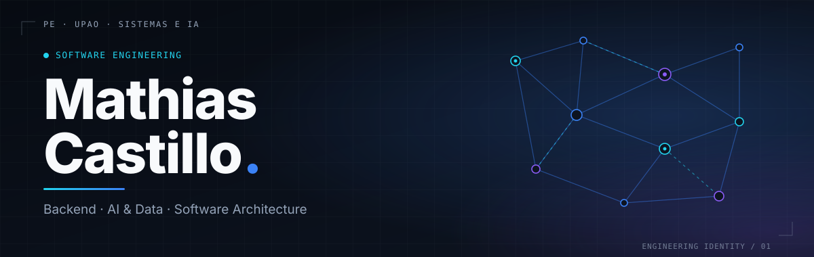

 

**Estudiante de Ingeniería de Sistemas e IA · UPAO, Perú · 6.º ciclo**

Construyo sistemas completos: del modelado del problema al backend, la interfaz y los datos.

 

 

---

### 01 &nbsp;/&nbsp; Sobre mí

Estudio Ingeniería de Sistemas e IA en la Universidad Privada Antenor Orrego. Me interesa entender el problema antes de escribir código: definir el alcance en historias de usuario, diseñar la arquitectura y después implementar. Trabajo con Scrum y XP, y mis proyectos combinan frontend, backend, bases de datos y componentes de IA.

Estoy en etapa de formación: lo que sigue es lo que he usado en proyectos y lo que estoy aprendiendo, separado a propósito.

---

### 02 &nbsp;/&nbsp; Stack técnico

<table>
<tr>
<td width="50%" valign="top">

**Lenguajes** 

**Backend** 

**Frontend** 

</td>
<td width="50%" valign="top">

**Bases de datos** 
 
También Neon (PostgreSQL serverless)

**IA y datos** 

**Herramientas** 

</td>
</tr>
</table>

**En aprendizaje:** infraestructura como código, CI/CD y servicios de mensajería en AWS (SQS, SNS, EventBridge), a nivel de curso.

---

### 03 &nbsp;/&nbsp; Proyectos destacados

<table>
<tr>
<td width="50%" valign="top">

**`P-01` Plataforma Estudio AI** 
FULL STACK · IA GENERATIVA

Herramienta de estudio que genera resumen general y esencial a partir de texto o PDF, y mapas conceptuales con IA. Frontend en React + Vite, backend en FastAPI que llama a la API de OpenAI.

**Problema:** condensar material de estudio extenso. 
**Decisiones:** una sola llamada devuelve ambos resúmenes; el PDF se procesa sin guardarse; sin base de datos; acceso con Google (OAuth); la clave de OpenAI vive solo en el backend.

[Repositorio](https://github.com/mathiassimoncastillosolano-eng/Plataforma-Estudio---AI) · [Demo](https://plataforma-estudio-ai.vercel.app)

</td>
<td width="50%" valign="top">

**`P-02` RutaLibre** 
FRONTEND · PORTAL WEB

Portal web de agencia de transporte terrestre: búsqueda de pasajes, registro e inicio de sesión, compra y tickets electrónicos.

**Problema:** reunir la adquisición de pasajes en un solo flujo. 
**Stack:** React + Vite con datos simulados; backend en preparación. Planificado con Scrum (épica, historias de usuario, Sprint Backlog).

[Repositorio](https://github.com/mathiassimoncastillosolano-eng/Portal---Transportes)

Proyecto en desarrollo

</td>
</tr>
<tr>
<td width="50%" valign="top">

**`P-03` Agente Educativo Inteligente** 
MACHINE LEARNING · DATOS

Modelo de regresión que estima el nivel de conocimiento (0–1) de un estudiante por concepto y período de práctica.

**Problema:** personalizar el seguimiento del aprendizaje. 
**Trabajo realizado:** dataset sintético de 125 000 registros, diseñado para evitar fuga de datos entre períodos.

[Código y dataset](https://github.com/mathiassimoncastillosolano-eng/Plataforma-Estudio---AI/tree/main/ml)

Proyecto académico

</td>
<td width="50%" valign="top">

**`P-04` Sistema de Préstamos (NEXORA Finance)** 
SISTEMA EMPRESARIAL · BASE DE DATOS

Sistema de gestión y auditoría de préstamos para una financiera con varias agencias.

**Problema:** controlar clientes, solicitudes y préstamos con reglas de negocio claras. 
**Stack:** React, TypeScript, Vite y Tailwind, con datos simulados. Diseño de base de datos en Supabase en curso.

[Repositorio](https://github.com/mathiassimoncastillosolano-eng/Sistema-de-Prestamos)

Proyecto en desarrollo

</td>
</tr>
</table>

---

### 04 &nbsp;/&nbsp; Actividad en GitHub

Los lenguajes reflejan bytes de código en repositorios públicos, no nivel de dominio.

---

### 05 &nbsp;/&nbsp; Foco actual

- Arquitectura backend y diseño de APIs (FastAPI)
- Modelado de bases de datos relacionales en PostgreSQL / Supabase
- Machine Learning aplicado a educación
- Infraestructura como código y servicios cloud

---

### 06 &nbsp;/&nbsp; Contacto

[GitHub](https://github.com/mathiassimoncastillosolano-eng) · [LinkedIn](https://www.linkedin.com/in/mathias-simon-castillo-solano-aa60a5391/)